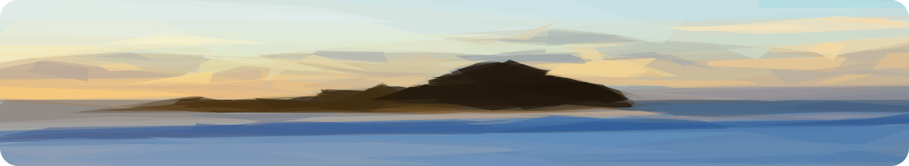

<!-- Generated daily from .github/README.template.md by .github/workflows/rotate.yml. Edit the template, not this file. -->

<picture><source media="(prefers-color-scheme: dark)" srcset="themes/ocean/intro-dark.svg"></picture>

<a href="https://agrawal-archit.vercel.app"><picture><source media="(prefers-color-scheme: dark)" srcset="themes/ocean/link-portfolio-dark.svg"></picture></a>
&nbsp;&nbsp;&nbsp;&nbsp;
<a href="https://agrawal-archit.vercel.app/Archit_Agrawal_AI_Software_Engineer_Resume.pdf"><picture><source media="(prefers-color-scheme: dark)" srcset="themes/ocean/link-resume-dark.svg"></picture></a>
&nbsp;&nbsp;&nbsp;&nbsp;
<a href="https://linkedin.com/in/agrawal-archit"><picture><source media="(prefers-color-scheme: dark)" srcset="themes/ocean/link-linkedin-dark.svg"></picture></a>
&nbsp;&nbsp;&nbsp;&nbsp;
<a href="mailto:architagrawal000@gmail.com"><picture><source media="(prefers-color-scheme: dark)" srcset="themes/ocean/link-email-dark.svg"></picture></a>

<picture><source media="(prefers-color-scheme: dark)" srcset="themes/ocean/projects-dark.svg"></picture>

<a href="https://github.com/architagrawal/aiJockey"><picture><source media="(prefers-color-scheme: dark)" srcset="themes/ocean/aijockey-dark.svg"></picture></a>
&nbsp;&nbsp;&nbsp;
<a href="https://agrawal-archit.vercel.app/projects/clash-royale-clan-analytics-platform"><picture><source media="(prefers-color-scheme: dark)" srcset="themes/ocean/clash-dark.svg"></picture></a>

<a href="https://github.com/architagrawal/srp-electric-mcp"><picture><source media="(prefers-color-scheme: dark)" srcset="themes/ocean/srp-dark.svg"></picture></a>
&nbsp;&nbsp;&nbsp;
<a href="https://agrawal-archit.vercel.app/projects/prismsplit"><picture><source media="(prefers-color-scheme: dark)" srcset="themes/ocean/prismsplit-dark.svg"></picture></a>

<picture><source media="(prefers-color-scheme: dark)" srcset="themes/ocean/quote-dark.svg"></picture>

